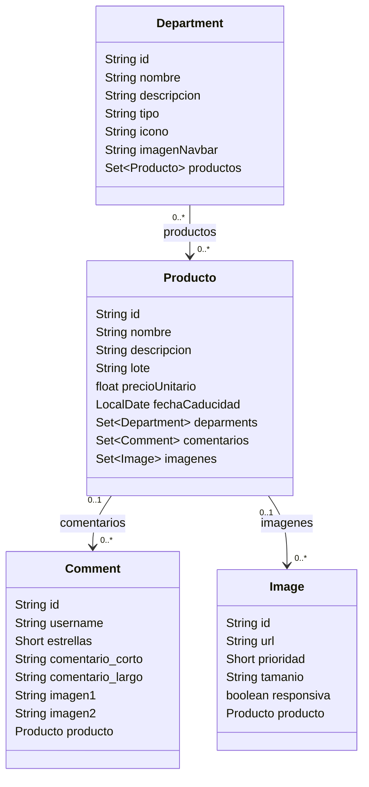

# Spring Many-to-Many

## Paso 0: Crear la base de datos

Si todavía no existe, crea la base de datos `chochos`:

```bash
psql -h db -U postgres -d postgres
```
```sql
CREATE USER chochos WITH PASSWORD 'chochos';
CREATE DATABASE chochos OWNER chochos;
```

## Paso 1: Crear los archivos necesarios

1. Crea el archivo `demo/src/main/java/com/example/demo/model/Department.java` con el modelo `Department`:

``` java
package com.example.demo.model;

import jakarta.persistence.Entity;
import jakarta.persistence.FetchType;
import jakarta.persistence.GeneratedValue;
import jakarta.persistence.GenerationType;
import jakarta.persistence.Id;
import jakarta.persistence.ManyToMany;
import jakarta.persistence.JoinTable;
import jakarta.persistence.JoinColumn;
import jakarta.persistence.Table;
import lombok.AllArgsConstructor;
import lombok.Builder;
import lombok.Getter;
import lombok.NoArgsConstructor;
import lombok.Setter;

import java.util.HashSet;
import java.util.Set;


@Getter
@Builder
@NoArgsConstructor
@AllArgsConstructor
@Table(name="Categorias")
@Entity
public class Department {
    @Id
    @GeneratedValue(strategy = GenerationType.UUID)
    @Setter
    private String id;
    private String nombre;
    private String descripcion;
    private String tipo;
    private String icono;
    private String imagenNavbar;
    
    @ManyToMany(fetch = FetchType.EAGER)
    @JoinTable(name = "producto_deparments",
            joinColumns = @JoinColumn(name = "product_id"),
            inverseJoinColumns = @JoinColumn(name = "deparments_id")
    )
    @Setter
    private Set<Producto> productos = new HashSet<>();

}
```
2. Crea el archivo `demo/src/main/java/com/example/demo/repo/categoriaRepo.java` con la interfaz `categoriaRepo`:

```java
package com.example.demo.repo;

import org.springframework.data.jpa.repository.JpaRepository;

import com.example.demo.model.Department;

public interface categoriaRepo extends JpaRepository<Department, String> {

}
```

Analiza el modelo `Department`. Observa las anotaciones `@ManyToMany` y `@JoinTable`. Responde: ¿Cómo afectará JPA a la base de datos? ¿Qué tabla creará y qué columnas tendrá?
R= JPA creara una tabla intermedia que servira para relacionar los productos con las categorias, en donde habra dos columnas una para guardar el ID del producto y la otra el ID de la categoría

## Paso 2: Modificar el modelo principal

1. En el archivo `demo/src/main/java/com/example/demo/model/Producto.java`, agrega la siguiente relación a la clase `Producto`:

```java
@ManyToMany(mappedBy = "productos",fetch = FetchType.EAGER)
    @JsonIgnore
    @Setter
    private Set<Department> deparments = new HashSet<>();
```
2. Investiga qué significa la anotación `@JsonIgnore` y explica por qué crees que se utiliza en `Producto`.
R=Sirve para evitar que un atributo se se incluya cuando se convierte en objeto a JSON, aqui es para evitar que se repitan los datos o que se genere un ciclo infinito al mostrar los productos y sus categorias, ya que ambos estan relacionados.

## Diagrama de clases

El diagrama muestra las relaciones entre las entidades del proyecto. La relación entre `Department` (categoría) y `Producto` es muchos-a-muchos; `Department` es el lado propietario y define la tabla de unión `producto_deparments`.



En las relaciones de comentarios e imágenes, cada elemento puede estar asociado a un producto; un producto puede tener varios comentarios y varias imágenes. La asociación con categorías se guarda en la tabla de unión, no como una columna directa en `producto`.

## Paso 3: Crear el controlador

1. Crea el archivo `demo/src/main/java/com/example/demo/controllers/CategoriaController.java` con la clase `CategoriaController`:

```java
package com.example.demo.controllers;

import java.util.List;
import java.util.Optional;
import java.util.Set;

import org.springframework.beans.factory.annotation.Autowired;
import org.springframework.web.bind.annotation.DeleteMapping;
import org.springframework.web.bind.annotation.GetMapping;
import org.springframework.web.bind.annotation.PathVariable;
import org.springframework.web.bind.annotation.PostMapping;
import org.springframework.web.bind.annotation.PutMapping;
import org.springframework.web.bind.annotation.RequestBody;
import org.springframework.web.bind.annotation.RestController;

import com.example.demo.model.Department;
import com.example.demo.model.Producto;
import com.example.demo.repo.categoriaRepo;
import com.example.demo.repo.productoRepo;

@RestController
public class CategoriaController {

@Autowired
categoriaRepo repo;
@Autowired
productoRepo repoProducto;
@GetMapping("categorias")
  public List<Department> findAllcategoria() {
    return this.repo.findAll();
  }

@PostMapping("categoria")
  public Department addcategoria(@RequestBody Department categoria) {

    return repo.save(categoria);
  }
  @PostMapping("addProductoCategoria/{productId}/{categoriaId}")
  public Department addcategoria(@PathVariable String productId ,@PathVariable String categoriaId) {
    Optional<Producto> p = repoProducto.findById(productId);
    Optional<Department> d = repo.findById(categoriaId);
    if(d.isPresent())
    if(p.isPresent()){
        
        d.get().getProductos().add(p.get());
    }
    return repo.save(d.get());

  }
  @GetMapping("categoria/producto/{productId}")
  public Set<Department>  getDepartmentsByProduct(@PathVariable String productId) {
    Optional<Producto> p = repoProducto.findById(productId);
    if(p.isPresent()){
      return  p.get().getDeparments();
    }
    return null;

  }

@GetMapping("categoria/{id}")
public Optional<Department> getById(@PathVariable String id) {
    return repo.findById(id);
}


@PutMapping("categoria/{id}")
public Department putDepartment(@PathVariable String id, @RequestBody Department categoria) {
    categoria.setId(id);
    return repo.save(categoria);
}

@DeleteMapping("categoria/{id}")
public String deleteDeparment(@PathVariable String id) {
    repo.deleteById(id);
    return "{\"success\":true}";
}
}

```
Observa el endpoint `addProductoCategoria/{productId}/{categoriaId}`, analiza el código y responde:

- ¿Cuál crees que es su función?
R=Relacionar un producto de una categoría existente, buscando amnos registros mediante sus IDs, agrega el producto a la lista de productsos de la categoría y guarda los cambios en la base de datos. 

- ¿Por qué se declaran dos repositorios: uno de tipo `categoriaRepo` y otro de tipo `productoRepo`?
R=Porque trabajan con uhna entidad diferente, una permite buscar y guardar categorías y la otra permite buscar productos, por lo que se necesitan ambas para crear la relación 

## Endpoints del ejercicio

La API se ejecuta en `http://localhost:8080`. Usa los IDs devueltos al crear cada recurso; son UUID generados automáticamente.

| Método | Ruta | Función |
|---|---|---|
| `GET` | `/productos` | Lista los productos. |
| `POST` | `/producto` | Crea un producto. |
| `GET` | `/producto/{id}` | Busca un producto por su ID. |
| `PUT` | `/producto/{id}` | Actualiza un producto. |
| `DELETE` | `/producto/{id}` | Elimina un producto. |
| `GET` | `/categorias` | Lista las categorías. |
| `POST` | `/categoria` | Crea una categoría. |
| `POST` | `/addProductoCategoria/{productId}/{categoriaId}` | Asocia un producto existente con una categoría existente. |
| `GET` | `/categoria/producto/{productId}` | Lista las categorías asociadas a un producto. |
| `GET` | `/categoria/{id}` | Busca una categoría por su ID. |
| `PUT` | `/categoria/{id}` | Actualiza una categoría. |
| `DELETE` | `/categoria/{id}` | Elimina una categoría. |

Las rutas distinguen entre singular y plural. Para los métodos `POST` y `PUT` que reciben un objeto, envía JSON con el encabezado `Content-Type: application/json`. `fechaCaducidad` debe usar el formato ISO `AAAA-MM-DD`.

## Paso 4: Probar la aplicación

1. Revisa la base de datos y observa las tablas creadas.

2. Compara las respuestas de tu archivo entregable con los resultados de estas pruebas y, si es necesario, corrígelas.

3. Si todavía no hay productos, crea uno. En la respuesta, guarda el valor de `id`:
```bash
curl --location 'http://localhost:8080/producto' \
--header 'Content-Type: application/json' \
--data '{"nombre":"Proteína de fresa", "descripcion":"2.2 kg", "lote":"123456", "precioUnitario":1500.5, "fechaCaducidad":"2026-05-04"}'
```

4. Crea una categoría:
```bash
curl --location 'http://localhost:8080/categoria' \
--header 'Content-Type: application/json' \
--data '{
    "nombre":"Suplementos",
    "descripcion":"Suplementos alimenticios, vitaminas y productos naturistas",
    "tipo":"Principal",
    "icono":"<i class='\''bi bi-capsule-pill'\''></i>",
    "imagenNavbar":"https://www.google.com/url?sa=t&source=web&rct=j&url=https%3A%2F%2Fnovanaturaclub.com%2Fsuplementacion-en-deportistas%2F%3Fsrsltid%3DAfmBOor8MBqGUZpYp_4gMRgV4IY5ddSt1CRJ9tXQDjSrBdqVlzf_9zcf&ved=0CBUQjRxqFwoTCMDM2YvFrJEDFQAAAAAdAAAAABAH&opi=89978449"
}'
```
5. Crea la relación entre ambos elementos:
> [!CAUTION]
> Sustituye `ID_PRODUCTO` y `ID_CATEGORIA` por los IDs generados en las respuestas anteriores. No incluyas las llaves `{}` en la URL.

```bash
curl --location --request POST 'http://localhost:8080/addProductoCategoria/ID_PRODUCTO/ID_CATEGORIA'
```

6. Revisa la base de datos y verifica que se haya agregado un registro a la tabla `producto_deparments`. También puedes consultar las categorías asociadas al producto:

```bash
curl 'http://localhost:8080/categoria/producto/ID_PRODUCTO'
```
